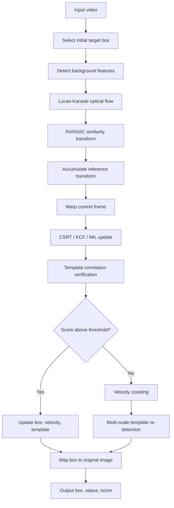

# Single Object Tracking with a Dynamic Camera

**Author:** [Rohon Alam](https://github.com/RohonAlam)  
**Repository:** [RohonAlam/va_project](https://github.com/RohonAlam/va_project)

| Attribute | Description |
|---|---|
| Domain | Computer Vision / Visual Object Tracking |
| Stack | Python, OpenCV-contrib, NumPy, Pandas, Streamlit, FFmpeg |
| Execution | CPU-based; no learned detector or GPU required |
| Main idea | Estimate background motion, stabilize frames, then track one selected object |

[Setup and installation guide](Setup_Guide.md)

---

## 1. Introduction

Single-object tracking estimates the location of a selected object throughout a video, given its initial bounding box. Camera movement complicates this task: a pan, tilt, rotation, or handheld shake can move most background pixels between consecutive frames. A local appearance tracker may then lose the target or drift onto a similar background region.

This project implements a classical CPU-oriented pipeline. It estimates global background motion using Shi–Tomasi features and pyramidal Lucas–Kanade optical flow, rejects inconsistent correspondences with RANSAC, and uses the resulting similarity transform to warp frames into a reference coordinate system. An OpenCV appearance tracker (CSRT, KCF, or MIL) operates on the stabilized frames. Template correlation verifies its prediction, while velocity-based coasting and local multi-scale template matching attempt recovery when confidence is low.

The method is designed for a manually initialized, single target. It is not a general object detector and does not automatically discover or re-identify arbitrary objects.

## 2. Project demonstration

Add a real screen recording or annotated output after capturing one:

```text
docs/assets/demo.gif
```

```markdown

```

The repository currently does not include a demo asset. Do not interpret this placeholder as a recorded experiment.

## 3. Pipeline overview



## 4. Method

### 4.1 Initial target region

The Streamlit interface defines the target box using percentages of the original frame dimensions. For frame width \(W\), height \(H\), and normalized coordinates \((u,v,a,b)\), the pixel box is

\[
x=uW,\quad y=vH,\quad w=aW,\quad h=bH.
\]

When processing width is reduced, both the frame and initial box are scaled by the same factor

\[
\alpha=\min\left(1,\frac{W_{\max}}{W}\right).
\]

Ground-truth CSV annotations supplied to the app or benchmark are expected to use the original video pixel coordinate system; evaluation scales them by \(\alpha\).

### 4.2 Background motion estimation

The current target region is excluded from background feature detection. The exclusion region is padded by

\[
p=0.25\max(w,h).
\]

Shi–Tomasi corners are detected in the previous grayscale frame (up to 400 candidates), then tracked into the current frame with pyramidal Lucas–Kanade optical flow. If fewer than ten usable correspondences remain, the implementation falls back to the identity transform for that frame.

For valid correspondences, `cv2.estimateAffinePartial2D` estimates a 2-D similarity transform using RANSAC with a 3-pixel reprojection threshold:

\[
\mathbf M_t =
\begin{bmatrix}
s\cos\theta & -s\sin\theta & t_x\\
s\sin\theta & s\cos\theta & t_y
\end{bmatrix}.
\]

This model represents translation, in-plane rotation, and uniform scale. It is not a full projective homography and cannot represent arbitrary perspective or parallax.

### 4.3 Reference-frame accumulation

Let \(\mathbf M_t\) map points from the previous image to the current image. The implementation accumulates a transform \(\mathbf A_t\) from current-image coordinates to reference coordinates:

\[
\mathbf A_t=\mathbf A_{t-1}\mathbf M_t^{-1},
\qquad
I_t^{\mathrm{stab}}=\mathcal W(I_t;\mathbf A_t).
\]

If the stabilized target approaches a 5% canvas margin, the implementation re-anchors the reference frame to limit long-term drift and clipping. The box is then mapped back to original-image coordinates using \(\mathbf A_t^{-1}\).

### 4.4 Appearance tracking and verification

The selected OpenCV tracker updates the target box on the stabilized frame. A candidate patch is converted to grayscale and resized to \(48\times48\). Its normalized correlation with the current template is computed using `cv2.TM_CCOEFF_NORMED`:

\[
\rho(P,T)=
\frac{\sum_i(P_i-\bar P)(T_i-\bar T)}
{\sqrt{\sum_i(P_i-\bar P)^2\sum_i(T_i-\bar T)^2}}.
\]

A prediction is accepted when its score is at least the configured tracking threshold (default \(0.30\)). When the score exceeds \(0.80\), the template is updated by an exponential blend:

\[
T_t=0.9T_{t-1}+0.1P_t.
\]

When verification fails, the tracker increments its lost counter and coasts the box using a smoothed velocity estimate:

\[
\mathbf v_t=0.7\mathbf v_{t-1}+0.3(\mathbf c_t-\mathbf c_{t-1}),
\qquad
\hat{\mathbf c}_{t+1}=\mathbf c_t+0.9\mathbf v_t.
\]

It then searches a local region at scales \(0.9,1.0,1.1\), comparing both the adaptive and initial templates. A detection is accepted when its correlation reaches the re-detection threshold (default \(0.55\)).

**Limitations:** template correlation can be unreliable under strong appearance change, severe blur, full occlusion, or visually similar backgrounds. Velocity coasting is a simple constant-velocity heuristic, not a Kalman filter. Camera-motion estimation can fail when the background has too few trackable features, strong parallax, or independently moving objects.

## 5. Evaluation protocol

Evaluation requires frame-level ground-truth boxes in a CSV with these columns:

```csv
frame,x,y,w,h
0,120,80,64,90
1,123,81,64,90
2,126,82,64,90
```

`frame` is a zero-based video frame index. Coordinates are pixel-valued `xywh` boxes in the original video resolution. The initial frame (frame 0) must be annotated because it initializes the tracker.

### 5.1 Metrics

For predicted box \(B_t^p\) and ground-truth box \(B_t^g\):

**Intersection over Union**

\[
\operatorname{IoU}_t=
\frac{|B_t^p\cap B_t^g|}{|B_t^p\cup B_t^g|}.
\]

**Success rate at 0.50**

\[
\operatorname{SR}_{0.5}=
\frac{1}{N}\sum_{t=1}^{N}
\mathbb{1}[\operatorname{IoU}_t\geq0.5].
\]

**Center Location Error**

\[
\operatorname{CLE}_t=
\sqrt{(c_{x,t}^p-c_{x,t}^g)^2+
      (c_{y,t}^p-c_{y,t}^g)^2}.
\]

**Lost-frame rate and tracking retention**

\[
R_{\mathrm{lost}}=
\frac{\#\{\text{frames with status=lost}\}}{N},
\qquad
R_{\mathrm{retained}}=1-R_{\mathrm{lost}}.
\]

**Processing throughput**

\[
\operatorname{FPS}_{\mathrm{processing}}=
\frac{\text{number of processed frames}}{\text{wall-clock processing time}}.
\]

Processing FPS is not necessarily equal to the source video's playback FPS. Report hardware, processing width, tracker, and compensation setting alongside it.

### 5.2 Ablation matrix

Run the benchmark for each available tracker and both camera-motion settings:

| Tracker | Compensation off | Compensation on |
|---|---:|---:|
| CSRT | To measure | To measure |
| KCF | To measure | To measure |
| MIL | To measure | To measure |

Keep the video, initialization box, processing width, and frame limit fixed across each pair. Use the same annotated frame indices for all comparisons. A tracker may not be available in every OpenCV build; the application lists the trackers available in the installed build.

## 6. Experimental results

No verified ground-truth dataset or benchmark run is included in the supplied repository files. Therefore, quantitative results are intentionally not fabricated here.

After running `benchmark.py`, populate a results table using the generated summary:

| Video | Tracker | Compensation | Mean IoU | SR@0.50 | Mean CLE (px) | Lost rate | Processing FPS |
|---|---|---|---:|---:|---:|---:|---:|
| Your sequence | CSRT | Off | — | — | — | — | — |
| Your sequence | CSRT | On | — | — | — | — | — |
| Your sequence | KCF | Off | — | — | — | — | — |
| Your sequence | KCF | On | — | — | — | — | — |
| Your sequence | MIL | Off | — | — | — | — | — |
| Your sequence | MIL | On | — | — | — | — | — |

Do not compare results from different videos or resolutions as if they were controlled ablations. Report failures and missing annotations, not just successful sequences.

## 7. Running the application and benchmark

The Streamlit app supports video upload, initial box selection, tracker selection, optional camera-motion compensation, processing-width selection, and annotated-video/trajectory downloads. An optional ground-truth CSV displays IoU, success rate, and CLE for overlapping annotated frames.

CLI example:

```bash
python benchmark.py --video sample.mp4 --gt ground_truth.csv \
  --tracker CSRT --compensate --max-width 640 \
  --output predictions.csv
```

Omit `--compensate` for the uncompensated baseline. Run the command again with `--tracker KCF` or `--tracker MIL` to compare trackers. The command prints summary metrics and saves per-frame predictions and evaluation values to the requested CSV.

## 8. Conclusion and future work

The project combines background-motion estimation, similarity-transform stabilization, classical appearance tracking, correlation-based verification, and local template recovery in a CPU-oriented pipeline. Its effectiveness should be established experimentally across controlled camera-motion sequences using frame-level ground truth.

Potential extensions include forward-backward optical-flow consistency checks, a full affine motion model, a Kalman filter for target-state estimation, scale-adaptive tracking, color-aware appearance models, and standardized evaluation on public tracking benchmarks.
